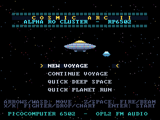
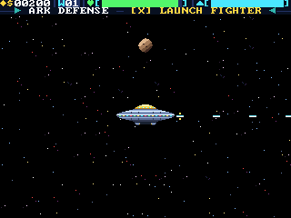
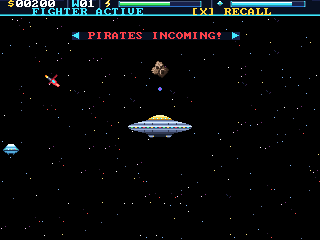
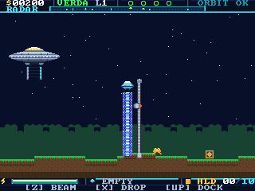
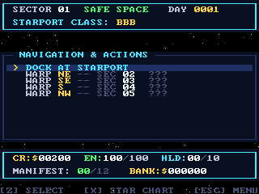
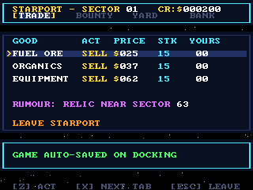
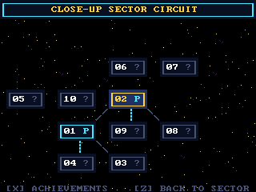

# Cosmic Arc II (Picocomputer RP6502)

A full port of **Cosmic Arc II** (originally built for the Atari 7800 + AstroCart) to the **Picocomputer RP6502**, taking advantage of the RP6502's 8 MHz 65C02 CPU, 320×240 3-plane 4bpp VGA graphics, hardware tilemap scrolling, Yamaha OPL2 FM audio, USB keyboard/gamepad input, and `SAVE:` filesystem persistence.



## Features

- **64-Sector Seeded Galaxy**: 12×8 grid-laid TradeWars-style galaxy with two-way and one-way warps, four threat tiers (Safe Space, Core, Mid-Rim, Outer Rim), 11 starports, planets, nebulae, and the Outer-Rim Relic.
- **Navigation & Charts**: Sector View, interactive 12×8 Galactic Star Chart with fog-of-war inspection, and Close-Up Sector Circuit Chart.
- **Deep Space Combat**: Defend the Ark along 8 equal-arrival firing lanes with energy-neutral point-defense lasers, or launch the **Fighter** (8-way directional flight with inertia, screen wrap, twin blasters, tether energy, invulnerable recall) while the Ark's 8-way auto-turret covers you. Battle **Raiders**, **Gunships** with homing **Missiles**, and collect **Salvage Pods** for Ark energy.
- **Planetary Extraction**: Smooth hardware-scrolled 1024-pixel wrapping worlds across 6 palettes (`VERDA`, `RUBRA`, `GLACI`, `UMBRA`, `ARENA`, `TOXIS`), Ark docking tunnel, shimmering tractor beam, 6 alien creature species with reactive AI, heavy ore crates, synchronized sweeping tower defense guns with screen-wide pulses, the 45-second meteor storm with docked Ark laser defense, and live 16-cell Planet Scanner.
- **Starports & Economy**: Tabbed menus for Commodities (dynamic stock & tier pricing + Relic rumours), Bio-Bounty (sell specimens or keep 2/2 pairs for the Ark manifest), Shipyard (energy recharge, hull upgrades up to 200, cargo holds 10/15/20), and Safe Space Bank (savings survive Ark loss).
- **Escape Pod & 16 Achievements**: Losing the Ark launches the emergency escape pod back to Sector 1 (keeping bank savings, star chart, and achievements). Track 16 achievements on the 4×4 Achievements screen.
- **3-Slot Persistence**: Automatic save on docking at any starport to `SAVE:ca2_s0.dat` .. `ca2_s2.dat`.
- **OPL2 FM Audio**: 5 looping streamed VGM music tracks (`Title`, `Map`, `Space`, `Pirates`, `Planet`) on channels 0–5 plus 16 priority-managed FM sound effects on channels 7–8.
- **No MathUnit Required**: Software fixed-point trig, octant `atan2`, fast `hypot`, and 32-bit xorshift RNG in `src/math_fixed.c` running natively on the 8 MHz 65C02.

| Deep Space | Fighter & Pirates | Planet Extraction |
|---|---|---|
|  |  |  |

| Sector View | Starport | Close-Up Circuit |
|---|---|---|
|  |  |  |

## Controls

| Action | Keyboard | Gamepad |
|---|---|---|
| Move / Aim / Menu | Arrow Keys or `WASD` | D-Pad / Stick |
| Fire / Tractor Beam / Select | `Z`, `J`, or `Space` | A / R1 |
| Launch-Recall Fighter / Drop Cargo / Chart / Next Tab | `X`, `K`, `C`, or `Tab` | B / X / L1 |
| Start / Pause / Leave / Erase Slot | `Enter`, `P`, or `Esc` | Start |

## Building & Running

Requires **LLVM-MOS** (`mos-rp6502-clang`), **CMake 3.28+**, and **Python 3** (standard library only).

```bash
# Configure & build native ROM + web player zip
cmake --preset llvm-mos/Release
cmake --build --preset llvm-mos/Release

# Play in the bundled RP6502 emulator
build/llvm-mos/release/RP_CosmicArc_II/rp6502-emu \
    build/llvm-mos/release/RP_CosmicArc_II/RP_CosmicArc_II.rp6502

# Run automated headless playtest & save/continue check
python3 tools/playtest.py
```

### Regenerating Art & Audio (optional)

All generated assets are committed, and can be regenerated with standard-library Python 3:

```bash
python3 tools/gen_art.py    # 4bpp indexed PNG sprite & tile sheets + src/gen/assets.h
python3 tools/gen_sfx.py    # music/sfx.bin + src/gen/sfx_ids.h
python3 tools/gen_music.py  # music/{Title,Map,Space,Pirates,Planet}.vgm
```

## License

GPL-3.0, matching the rest of the Cosmic Arc series.
